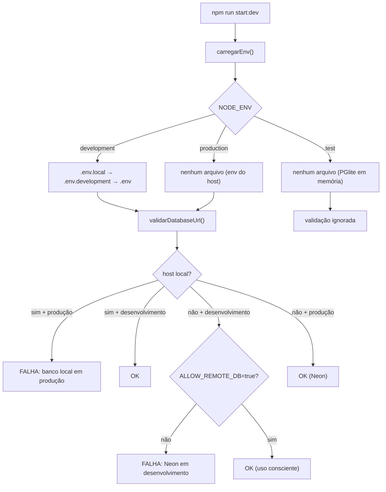

# 02 — Ambientes: local × produção

Como a API decide **qual banco usar** e como impedir o acidente mais caro
possível: rodar desenvolvimento contra o banco de produção.

---

## 1. Visão geral



Arquivos envolvidos:

| Arquivo | Papel |
|---|---|
| `src/config/load-env.ts` | Resolve o ambiente e carrega os arquivos na ordem correta |
| `src/config/banco-de-dados.ts` | Valida a `DATABASE_URL`, detecta local/Neon, mascara a senha |
| `src/config/app-config.ts` | Monta o `AppConfig` (porta, CORS, JWT, banco, Swagger) |
| `prisma.config.ts` | CLI do Prisma usando o **mesmo** loader |
| `prisma/seed.ts` | Seed usando o mesmo loader |
| `scripts/check-env.ts` | Diagnóstico (`npm run env:check`) |

---

## 2. Precedência dos arquivos `.env`

`process.loadEnvFile` **nunca sobrescreve** variável já definida. Portanto o
primeiro arquivo carregado vence — e é por isso que a ordem é do mais específico
para o mais geral:

| Ordem | Arquivo | Uso típico |
|---|---|---|
| 1º | `.env.local` | Ajustes pessoais da máquina (não versionado) |
| 2º | `.env.<NODE_ENV>` | Ex.: `.env.development` |
| 3º | `.env` | Configuração local compartilhada (gerado pelo setup) |

Regras especiais:

- `NODE_ENV=production` → **nenhum arquivo é carregado**. Tudo vem do host.
- `ENV_FILE=<caminho>` → força um único arquivo (útil em CI). Funciona até em
  produção, mas é explícito: quem define sabe o que está fazendo.
- Variável já presente no ambiente do processo sempre vence o arquivo.

> `NODE_ENV` ausente é tratado como `development`. O log de bootstrap mostra o
> ambiente efetivo e quais arquivos foram carregados.

---

## 3. Regras de validação da `DATABASE_URL`

Implementadas em `validarDatabaseUrl()` (`src/config/banco-de-dados.ts`) e
executadas no boot — a API **não sobe** se a URL estiver errada.

| # | Situação | Resultado |
|---|---|---|
| 1 | Variável ausente/vazia | ❌ `DATABASE_URL é obrigatória` + como resolver |
| 2 | Esquema diferente de `postgresql://` | ❌ `esquema "mysql:" não é suportado` |
| 3 | URL malformada | ❌ `não é uma URL` (com a URL mascarada) |
| 4 | Sem nome de banco no final | ❌ `nome do banco ausente` |
| 5 | `NODE_ENV=production` + host local | ❌ `aponta para o host local "localhost"` |
| 6 | `development` + host remoto, sem `ALLOW_REMOTE_DB` | ❌ `aponta para o Neon (produção) em ambiente "development"` |
| 7 | `development` + host remoto + `ALLOW_REMOTE_DB=true` | ✅ |
| 8 | `production` + host remoto | ✅ |
| 9 | Host remoto sem `sslmode` | ✅ + **warning** no log (Neon exige TLS) |
| 10 | `NODE_ENV=test` | ⏭️ validação ignorada (banco é PGlite injetado) |

Hosts tratados como locais: `localhost`, `127.0.0.1`, `::1`, `0.0.0.0`,
`host.docker.internal` e faixas privadas (`10.x`, `192.168.x`, `172.16–31.x`).

**A senha nunca é logada.** `mascararUrl()` troca a senha por `***` antes de
qualquer `logger.log`.

Exemplos verificados em teste:

```text
NODE_ENV=production  + localhost          → falha: host local em produção
NODE_ENV=development + *.neon.tech        → falha: Neon em desenvolvimento
NODE_ENV=development + *.neon.tech + ALLOW_REMOTE_DB=true → ok
NODE_ENV=production  + *.neon.tech        → ok (ssl)
```

Cobertura: `src/config/banco-de-dados.spec.ts` (13 casos).

---

## 4. Banco local (desenvolvimento)

| Item | Valor |
|---|---|
| Servidor | PostgreSQL 18 (`postgresql-x64-18`), porta `5432` |
| Banco | `tripplanner_dev` |
| Role | `tripplanner` (LOGIN + CREATEDB) |
| Senha | Gerada aleatoriamente pelo setup e gravada em `.env` |
| `CREATEDB` | Necessário para o *shadow database* do `prisma migrate dev` |

Por que uma role dedicada e não o `postgres`:

- a senha do superusuário **não** fica gravada em disco;
- a aplicação roda com o mínimo de privilégio;
- `CREATEDB` é concedido apenas para permitir o shadow database das migrations
  em desenvolvimento.

O provisionamento é feito por `scripts/setup-local-db.ps1`
(`npm run db:setup:local`), que é idempotente: rodar de novo reaproveita a senha
já presente no `.env`.

---

## 5. Produção (Neon)

### 5.1 Variáveis (painel do host)

| Variável | Valor | Observação |
|---|---|---|
| `NODE_ENV` | `production` | A Vercel já define automaticamente |
| `DATABASE_URL` | connection string **pooled** | host contém `-pooler`; `?sslmode=require` |
| `DATABASE_URL_UNPOOLED` | connection string **direta** | usada por migrations/DDL |
| `JWT_SECRET` | segredo forte | obrigatório em produção, senão a API não sobe |
| `CORS_ORIGINS` | domínio do frontend | separado por vírgula |
| `SWAGGER_ENABLED` | `false` | padrão em produção |
| `PUBLIC_API_URL` | URL pública da API | opcional; aparece em `servers` no OpenAPI |

Gerar o segredo:

```powershell
node -e "console.log(require('crypto').randomBytes(48).toString('hex'))"
```

### 5.2 Pooled vs. unpooled

No Neon, `DATABASE_URL` passa pelo PgBouncer. Migrations e DDL usam advisory
lock e devem rodar na conexão **direta** — por isso:

- `prisma.config.ts` usa `DATABASE_URL_UNPOOLED` quando presente;
- `scripts/migrate-deploy.js` (chamado pelo `npm run build`) faz o mesmo;
- a aplicação em runtime usa `DATABASE_URL` (pooled).

### 5.3 Migrations no deploy

`npm run build` executa `node scripts/migrate-deploy.js` antes do `nest build`.
Esse script lê **apenas** `process.env` (não carrega `.env`), de propósito: um
build local nunca aplica migrations por acidente. Sem URL definida, o passo é
ignorado com `exit 0` — não quebra o build de quem só quer compilar. No host
(Vercel), as variáveis são reais e as migrations rodam no build.

### 5.4 Pendência: runtime na Vercel

Hoje `start:prod` é `node dist/main` — um processo long-lived. A Vercel executa
funções serverless, que precisam de um handler exportado (padrão
`api/index.ts` + `@vercel/node`). **Isso ainda não está implementado.** Ver
pendência [P-01](05-decisoes-e-pendencias.md#p-01--handler-serverless-para-vercel).

---

## 6. Segurança

- `.env` e `.env.*` são ignorados pelo Git; apenas `*.example` são versionados.
- Nenhum segredo é impresso: `mascararUrl()` cobre logs e mensagens de erro.
- O setup grava o `.env` em UTF-8 **sem BOM** (o `process.loadEnvFile` do Node
  não lida bem com BOM).
- `ALLOW_REMOTE_DB` é a única porta para usar um banco remoto em
  desenvolvimento, e é `false` por padrão.
